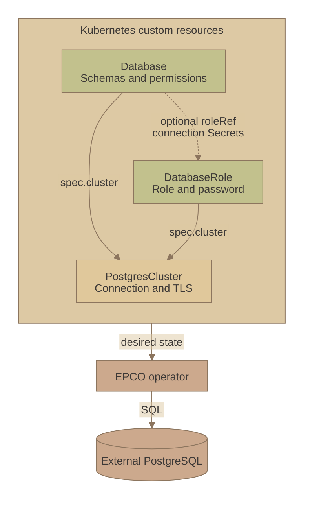

# External PostgreSQL Control Operator

Manage PostgreSQL roles, databases, and permissions with Kubernetes manifests.
EPCO connects to existing PostgreSQL servers and keeps database access and application credentials in sync.

Supports PostgreSQL **15, 16, 17, and 18**.

## Features

- [Roles, databases, schemas, and extensions](examples/api-proposal/full.yaml).
- [Separate owner, migration, runtime, and read-only access](examples/microservice/separate-migrations-and-admin-readonly.yaml).
- [Permissions for specific tables](examples/api-proposal/llm-readonly.yaml), including [grant removal](examples/api-proposal/llm-readonly-after-removal.yaml).
- [Generated passwords and application connection Secrets](examples/microservice/service-owner-and-admin-readonly.yaml), or [passwords you provide](examples/microservice/orders-service-password-provided.yaml).
- [Shared PostgreSQL connections across namespaces](examples/cross-namespace/infra-connection.yaml).
- [TLS connections](examples/microservice/postgres-connection.yaml), with [AWS RDS examples](examples/api-proposal/aws-rds.yaml).

## How it works

`DatabaseRole` and `Database` share a `PostgresCluster` connection. EPCO uses these declarations to manage SQL objects on your PostgreSQL server.



## Install

Choose Helm or Flux for a fresh installation. Install one EPCO release per Kubernetes cluster.

### Helm

```sh
helm install epco oci://ghcr.io/vterdunov/charts/external-postgres-control-operator \
  --version 0.1.9 \
  --namespace epco-system \
  --create-namespace
```

### Flux

Add these resources to your Flux configuration:

```yaml
apiVersion: source.toolkit.fluxcd.io/v1
kind: OCIRepository
metadata:
  name: epco
  namespace: flux-system
spec:
  interval: 1h
  url: oci://ghcr.io/vterdunov/charts/external-postgres-control-operator
  ref:
    tag: "0.1.9"
  layerSelector:
    mediaType: application/vnd.cncf.helm.chart.content.v1.tar+gzip
    operation: copy
---
apiVersion: helm.toolkit.fluxcd.io/v2
kind: HelmRelease
metadata:
  name: epco
  namespace: flux-system
spec:
  interval: 30m
  releaseName: epco
  targetNamespace: epco-system
  chartRef:
    kind: OCIRepository
    name: epco
  install:
    createNamespace: true
    crds: Create
    strategy:
      name: RetryOnFailure
  upgrade:
    crds: CreateReplace
    strategy:
      name: RetryOnFailure
```

### Upgrades

With Flux, update `spec.ref.tag` in the OCIRepository. Flux updates the CRDs before upgrading the operator.

With Helm CLI, apply the target release's CRDs, then upgrade its chart.
Replace `X.Y.Z` with a chart version that includes `crds.yaml` (added after `0.1.9`):

```sh
EPCO_VERSION=X.Y.Z
EPCO_CRDS_URL="https://github.com/vterdunov/external-postgres-control-operator/releases/download/chart-v${EPCO_VERSION}/crds.yaml"
kubectl apply --server-side --force-conflicts -f "$EPCO_CRDS_URL" &&
kubectl wait --for=condition=Established --timeout=120s -f "$EPCO_CRDS_URL" &&
helm upgrade epco oci://ghcr.io/vterdunov/charts/external-postgres-control-operator \
  --version "$EPCO_VERSION" --namespace epco-system --wait
```

Pass any custom `--values` options to `helm upgrade`. Both methods keep CRDs on uninstall.

See the [example guide](docs/examples.md) to connect your PostgreSQL server and configure application access.
The [documentation](docs/README.md) covers the API, lifecycle, and development.

## License

Licensed under the [Apache License 2.0](LICENSE).
